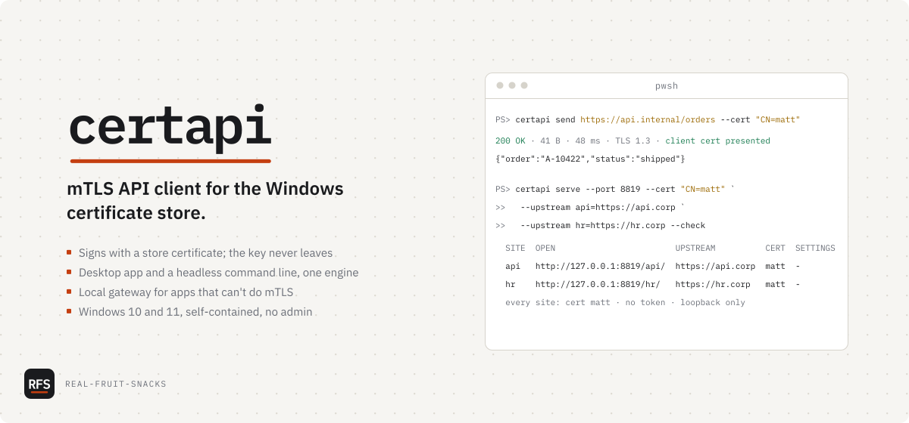

# certapi

mTLS API client for the Windows certificate store

<picture>
  <source media="(prefers-color-scheme: dark)" srcset="docs/assets/cover-dark.svg">
  
</picture>

```powershell
mkdir "$env:LOCALAPPDATA\certapi" -Force; cd "$env:LOCALAPPDATA\certapi"
curl.exe -LO https://github.com/Real-Fruit-Snacks/certapi/releases/latest/download/certapi.exe
curl.exe -LO https://github.com/Real-Fruit-Snacks/certapi/releases/latest/download/ApiTester.App.exe
```

That's `certapi.exe` (command line) and `ApiTester.App.exe` (desktop) from the [latest release](https://github.com/Real-Fruit-Snacks/certapi/releases/latest). Both are self-contained: no installer, no admin rights. Add the folder to your `PATH` to run `certapi` from any prompt.

Some internal endpoints don't take a password. They ask the browser to choose a certificate and complete a mutual-TLS handshake, and most API clients want that certificate and its private key as files on disk, which enterprise and smart-card certificates deliberately don't allow. certapi picks the certificate from your Windows certificate store — the Personal store, `CurrentUser\My`, or the machine's `LocalMachine\My` — and lets Windows sign the handshake, so the key never leaves the store and never has to be exportable. A `.pfx` or `.pem` file works too. With no certificate selected it is an ordinary HTTP client. I wrote it for my own internal APIs; it assumes Windows 10/11 and nothing else.

Site: [real-fruit-snacks.github.io/certapi](https://real-fruit-snacks.github.io/certapi/) · Handbook: [`wiki/`](wiki/README.md) · [Changelog](CHANGELOG.md)

## What's in it

Two front ends over one engine (`ApiTester.Core`). The desktop app covers everything below with a window; `certapi` covers it from a script.

| Command | Does |
|---|---|
| `certapi send <url>` | Sends one request with a store certificate; `--capture`, `--cookie-jar`, `--diff`, `--har`, `--trace`, `--wire`, `--retry` |
| `certapi run <name\|path\|.har>` | Runs saved requests, a collection, a chain or a HAR as a pass/fail suite with exit codes |
| `certapi doctor <url>` | Connects stage by stage and names the stage that broke, with the CAs the server accepts |
| `certapi serve` | Local mTLS gateway for apps that can't do client certificates, in front of one site or many: named sites, a certificate and settings per site, one origin each with `--vhost`, `--browser` for SSO flows, a whole gateway in a profile |
| `certapi mock` | Standing test server over HTTP, HTTPS or mTLS, or a replay of a captured HAR |
| `certapi grpc list\|call` | gRPC behind mutual TLS, via server reflection or `--protoset` |
| `certapi token` | OAuth 2.0 client-credentials, password, refresh, device code (auth-code + PKCE is in the app) |
| `certapi ws` / `certapi sse` | WebSocket and Server-Sent Events through the same certificate |
| `certapi fuzz <url>` | Probes a wordlist to map an undocumented API |
| `certapi bench <url>` | p50/p90/p99 latency over a pooled connection; retries forced off |
| `certapi import` / `certapi export` | cURL, Postman, OpenAPI, HAR, workspaces, markdown notes |
| `certapi mcp` | Model Context Protocol server for an AI agent, behind a host allowlist |

Also: `certs`, `trust`, `proxy`, `connections`, `config`, `selftest`, and `completion` for PowerShell tab completion. `certapi <command> --help` lists every flag, curl habits (`-k`, `-i`, `-u`, `-d @file`, …) work, and a mistyped flag names the one you meant; the [CLI reference](wiki/21-CLI-Reference.md) has them on one page.

```powershell
certapi send https://internal.corp/api/orders --cert "CN=matt"
certapi send https://internal.corp/auth --capture token=access_token --workspace team.json
certapi run "internal api" --env Prod --json
certapi doctor https://internal.corp/api/orders --cert "CN=matt"
certapi serve https://internal.corp --port 8819 --cert "CN=matt" --browser
certapi serve --port 8819 --cert "CN=matt" --upstream api=https://api.corp --upstream hr=https://hr.corp --check
certapi serve --port 8819 --cert "CN=matt" --allow "*.corp" --proxy http://proxy.corp:8080 --ca-file corp-root.pem
certapi serve --profile corp
certapi --version
```

Body goes to stdout, diagnostics to stderr. Exit codes: 0 success · 1 failure · 2 usage · 3 data.

## Tested on

- Windows 11 23H2 · .NET 9 SDK 9.0.x
- Windows Server 2022 · headless `certapi` only
- GitHub Actions `windows-latest` on every push: build with warnings as errors, then `dotnet test`
- *Not* tested: Windows 10 before 22H2, ARM64 Windows. Probably works, no promises.

## Known issues

- The Rendered view needs the Edge WebView2 runtime. Windows 11 ships it; without it that one tab says so and everything else works.
- `certapi serve` does not proxy gRPC.
- `--protoset` needs a descriptor set you already have. certapi does not compile `.proto` files.
- `--http3` is Windows 11 / Server 2022 and direct connections only.
- Through a proxy, the TLS version, cipher and certificate-presented details are not visible. `--no-proxy` brings them back.
- Over the plaintext gateway, `__Host-`/`__Secure-` cookies cannot work; `serve --tls` is the fix.
- `serve` does not rewrite absolute URLs inside HTML/JS bodies. A site that links to its own hostname leaves the gateway on those links; `--browser` fixes headers (Location, cookies, CORS), not bodies. A site that uses absolute *paths* (`/static/app.js`, `Path=/` cookies) works under `--vhost`, which gives each upstream its own origin, or with `--referer-fallback`.
- `serve --vhost` with `--tls` warns in the browser once per virtual host: the generated certificate names `127.0.0.1` only.
- `serve --windows-auth` answers the upstream's challenge, not the proxy's; a proxy that wants Negotiate is handled by the transport as before.
- `certapi doctor` cannot probe through a SOCKS proxy; `send --debug --trace` can.
- A proxy that itself requires a client certificate (mTLS to the proxy) is not supported; .NET's HTTP stack cannot present one to a proxy.
- `--pac` and `--cert-pin` are Windows-only (WinHTTP, CNG).
- `--sni` works on direct connections only, and not through `serve`.

## Configuration

Nothing is required. Optional:

- `certapi.config.json`, found by walking up from the working directory, or named with `--config` or `CERTAPI_CONFIG`, or at `%APPDATA%\certapi\config.json`. Profiles hold certificate, proxy, bypass list, `caFile`, `tlsMin`, `connectTimeout`, revocation, retries, timeout, workspace, standing headers (added to every `send` and `run` request) and a whole `serve` gateway; `--profile corp` selects one, a typed flag wins (a switch a profile turns on stays on), `--no-config` ignores all of it. Any value may be `${env:NAME}`. `certapi config show` prints the profile in effect with secrets masked.
- Networks: the system proxy (WPAD/PAC) is the default; `HTTPS_PROXY`/`NO_PROXY` are honoured (`--no-env-proxy` ignores them); `--proxy` (http or socks), `--pac <url|file>`, `--no-proxy`, `--noproxy <list>` override per run; `--offline` touches nothing but the request; `-4`/`-6` pick an address family. A TLS-intercepting proxy's private root goes in `--ca-file`, not `--insecure`. A pin can name the leaf, the issuer (`trust add --ca`) or the public key (`--spki`).
- Certificates: `--cert` by subject or thumbprint, narrowed by `--cert-issuer`/`--cert-serial`; `--cert-file` for PEM/PFX (it says which intermediates the store lacks); `--cert-pin` or `CERTAPI_CERT_PIN` for a smart card or HSM in a headless job.
- Gateway: `serve` fronts named sites (`--upstream api=https://api.corp` is at `/api/`), sites with their own certificate, trust, Windows auth and headers (`--routes <file>` or a profile's `serve.sites`), one origin per site (`--vhost`: `api.gw.localhost`), and any allowed host (`--allow`). It prints a table of what it built at start, and `--check` prints it without starting. It completes multi-step logins (`--browser`, `--cookie-jar [<file>]`, `--auto-token`, `--windows-auth`) and can be shared on a LAN (`--listen` + `--token`). List-valued flags (`--upstream`, `--allow`, `--routes`, `--noproxy`, `-H`, …) repeat and add up.
- `{{env:NAME}}` in a request reads the process environment, so a CI credential is never stored.
- State lives in `%APPDATA%\CertApiTester\state.json`. Secrets in it (tokens, cookies, passwords, secret variables, stored bodies) are DPAPI-encrypted for the Windows user. `certapi export workspace` strips them by default.

Build from source: `dotnet build` · `dotnet test --filter "Category!=StoreRoundTrip"` · `dotnet publish src/ApiTester.Cli -c Release -r win-x64 --self-contained -o publish`. Windows only; the app is WPF.

## License

MIT
