# certapi

mTLS API client for the Windows certificate store

<picture>
  <source media="(prefers-color-scheme: dark)" srcset="docs/assets/seal-dark.svg">
  
</picture>

```powershell
mkdir "$env:LOCALAPPDATA\certapi" -Force; cd "$env:LOCALAPPDATA\certapi"
curl.exe -LO https://github.com/Real-Fruit-Snacks/certapi/releases/latest/download/certapi.exe
curl.exe -LO https://github.com/Real-Fruit-Snacks/certapi/releases/latest/download/ApiTester.App.exe
```

- **Windows certificate store mTLS:** Signs mutual-TLS handshakes directly via `CurrentUser\My`, `LocalMachine\My`, smart cards/HSMs (non-exportable keys never leave the store), or `.pfx`/`.pem` files.
- **CLI + desktop over one engine:** Self-contained `certapi.exe` and WPF `ApiTester.App.exe` covering HTTP/1.1–3, OpenAPI, gRPC, WebSockets, SSE, SignalR, MQTT, OAuth 2.0, CORS auditing, TLS diagnostics (`doctor`), and a local mTLS gateway (`serve`).
- **Zero-install distribution:** Direct self-contained executables, Scoop manifest, SHA-256 verified `certapi update`, and offline release/dev kits.
- **DPAPI-encrypted local state:** Optional `certapi.config.json` profiles; stored tokens and secrets stay encrypted per Windows user.

## Documentation

- [Project Page](https://real-fruit-snacks.github.io/certapi/)
- [Quick Reference, Config, Known Issues & Build](docs/USAGE.md)
- [Complete Handbook (`wiki/`)](wiki/README.md) · [CLI Reference](wiki/21-CLI-Reference.md)
- [Changelog](CHANGELOG.md) · [Contributing](CONTRIBUTING.md) · [Security](SECURITY.md)

## License

MIT
